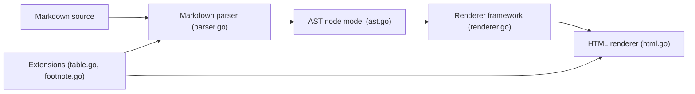

# yuin/goldmark

> CommonMark-compliant, extensible Markdown parser and converter in Go, for Go developers.

## The problem
Markdown libraries do not always keep the original syntax or positions, and handle emphasis and line breaks poorly in CJK.

## What it actually does
Parses Markdown into a syntax tree that keeps the source of each node, then a separate renderer produces HTML. Ships with extensions (tables, strikethrough, task lists, footnotes, definition lists, typography, GFM) and accepts custom extensions. v2 (at the start of its rollout) is a breaking rewrite, with generics and an AST that can be built programmatically. A v1 to v2 migration plugin is provided for Claude Code. Depends only on the standard library.

## How it is wired


## Trying it
```bash
go get github.com/yuin/goldmark/v2
/plugin marketplace add yuin/goldmark@v2
/plugin install migrate-goldmark-v1-to-v2@yuin-goldmark-v2
```

## Cost and gotchas
Free. Many third-party extensions do not support v2 yet; v1 remains the one to use in that case.

## What it is not
Not a security filter: raw HTML is omitted by default, but for untrusted content the README recommends a sanitizer such as bluemonday.

## Alternatives
- rushdown (cited in the README): Rust version.
- Lute and golang-commonmark (compared in the benchmarks).

## For you
Ignore unless you write Go: it is a Markdown rendering building block, not an AI tool.
