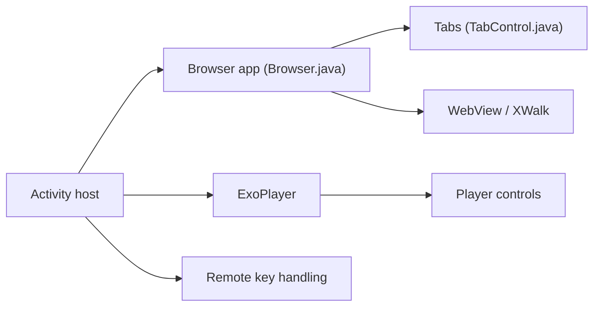

# yuliskov/SmartTubeLegacy

> Old YouTube client for Android TV and FireTV boxes, with no dependency on Google services.

## The problem
Android TVs and boxes without Google services have no YouTube client suited to the remote control and 4K.

## What it actually does
Android TV application with sign-in, multilingual search, 4K and automatic updates. At launch, the start screen chooses the playback mode: WebView or XWalk at 1080p, or ExoPlayer combined with one of the two for 4K; maximum resolution and codec are adjustable. The code is an adapted Android browser (tabs, controller, search engines) plus an ExoPlayer player.

## How it is wired


## Trying it
```bash
adb install -r SmartYouTubeTV_Orig.apk
```

## Cost and gotchas
Free, but the repo is archived (last push October 2023) with 447 open issues; installation goes through ADB or FireTV.

## What it is not
Not the maintained version: the name "Legacy" indicates an old project. It is unofficial and depends on YouTube, whose behavior can break it.

## Alternatives
No alternative named in the README.

## For you
Ignore: archived and off-topic for a data/AI profile.
