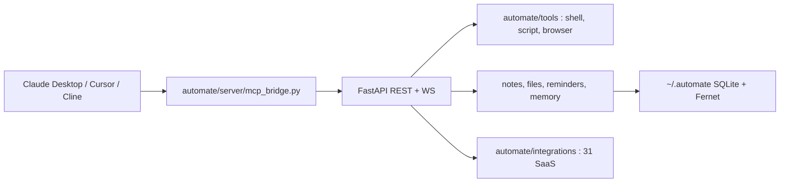

# yuruotong1/autoMate

> Local server that gives notes, files, memory and forty tools to any AI client.

## The problem
No AI client remembers anything from one provider to another.
Notes, files and reminders stay locked inside the tool of the day.

## What it actually does
A layer behind the chat, exposed as MCP-over-HTTP, that Claude Desktop, Cursor or Cline consume as tools.
Personal data: `notes.*`, `files.*` (content-addressed vault), `reminders.*`, `memory.*`,
and `search.find` as hybrid BM25 retrieval (SQLite FTS5) over notes and files in a single call.
Local executors (`shell.*`, `script.*`, `browser.*`, `desktop.*`), 31 SaaS connectors, 25 LLM providers.

## How it is wired


## Trying it
```bash
pip install automate-hub
automate
```

## Cost and gotchas
The base is free but audio transcription and autoMate Cloud are a paid Pro tier.
The token of the `/mcp/` endpoint is as good as a password: whoever has it can call `shell.exec` on your machine.

## What it is not
Not an autonomous agent: the brain remains your client, except in local web mode.
Not a managed service — the server runs at your place, with your keys.
Not ready for network exposure: it listens on `127.0.0.1` by default, and that is intentional.

## Alternatives
OpenClaw, presented as the complementary building block for messaging channels.

## For you
An interesting idea of a personal data store shared between agents; the `shell.exec` token calls for caution.
