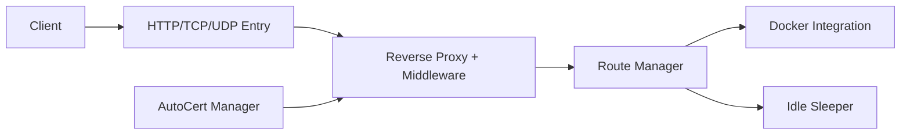

# yusing/go-proxy

> Lightweight reverse proxy (GoDoxy) with a WebUI, which discovers Docker containers and manages certificates.

## The problem
Exposing several self-hosted services behind subdomains without writing the routes by hand.

## What it actually does
Reads Docker or Podman containers, creates routes from labels (`proxy.aliases`), hot-reloads, handles Let's Encrypt via DNS-01, TCP/UDP proxying, OpenID Connect SSO, IP rules, and puts containers and Proxmox LXCs to sleep depending on traffic.

## How it is wired


## Trying it
```bash
/bin/sh -c "$(curl -fsSL https://raw.githubusercontent.com/yusing/godoxy/main/scripts/setup.sh)"
docker compose up -d
```

## Cost and gotchas
Wildcard DNS to configure; host network mode is mandatory. The installation script is executed directly from the web. Linux amd64 and arm64 only.

## What it is not
Not an ML tool; the README states that the repository is GoDoxy's (renamed).

## Alternatives
- NPM (Nginx Proxy Manager): cited only as a comparison for the route concept.

## For you
Ignore: useful for a homelab, but unrelated to data/AI; Traefik or Caddy are better known (outside the README).
