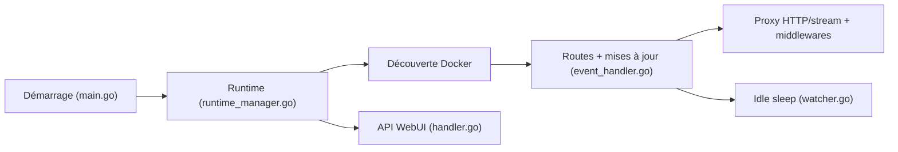

# yusing/godoxy

> Go reverse proxy with a web interface, Docker container discovery and Proxmox management, for homelabs.

## The problem
Exposing several container services behind domain names and certificates requires a continuously configured proxy.

## What it actually does
It lists Docker or Podman containers, reads their labels (`proxy.aliases`) and creates routes automatically, with hot reload. It offers HTTP proxying, TCP/UDP redirection, OpenID Connect SSO, ForwardAuth, middlewares, IP/country access rules, Let's Encrypt certificates (DNS-01), and metrics, logs and uptime in the web interface. It can put Docker or Proxmox LXC containers to sleep and wake them depending on traffic.

## How it is wired


## Trying it
```bash
/bin/sh -c "$(curl -fsSL https://raw.githubusercontent.com/yusing/godoxy/main/scripts/setup.sh)"
docker compose up -d
```

## Cost and gotchas
Free; wildcard DNS records to create, `host` network operation mandatory. Country rules require a MaxMind account. License not identified by GitHub. The setup script is downloaded and executed via curl.

## What it is not
Not a Kubernetes controller nor a service mesh. Several features (Proxmox, SSO) rely on the README's documentation, not verified in the code here.

## Alternatives
Not documented in the README (the term NPM is cited as an analogy for routes).

## For you
Worth watching for a personal server hosting ML services; check the license before any professional use.
