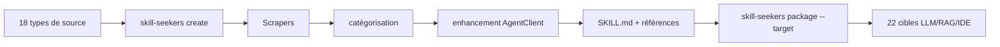

# yusufkaraaslan/Skill_Seekers

> Turns docs, repos, PDFs, videos and wikis into agent skills or RAG corpora.

## The problem
Preparing the same documentation for Claude, for a vector index and for the IDE's AI means re-scraping and re-formatting it three times.

## What it actually does
Eighteen input source types (documentation site, GitHub repo, local codebase, PDF, Word, EPUB, Jupyter, OpenAPI, PowerPoint, AsciiDoc, HTML, RSS, man page, YouTube/Vimeo/local video, Confluence, Notion, Slack/Discord exports) and 22 output targets (12 LLM platforms including `claude`, `gemini`, `openai`; 8 RAG and vector targets: LangChain, LlamaIndex, Haystack, Chroma, FAISS, Weaviate, Qdrant, Pinecone; plus `atlas` and `ibm-bob`). Three-layer discovery for SPA sites (`sitemap.xml` → `llms.txt` → headless browser). The C3.x pipeline analyzes a codebase through its AST, detects 10 GoF patterns across 9 languages, and extracts examples from tests. AI enhancement in API mode or in LOCAL mode through a CLI agent (no API cost). MCP server with 40 tools, automatic installation into 19 agents, optional SQLite FTS5 search index inside the skill.

## How it is wired


## Trying it
```bash
pip install skill-seekers
skill-seekers create https://docs.djangoproject.com/
skill-seekers package output/django --target claude
skill-seekers scan ./my-react-app --out ./configs/scanned/
python -m skill_seekers.mcp.server_fastmcp
```

## Cost and gotchas
API mode is billed by Anthropic, Gemini, OpenAI, Kimi or MiniMax; LOCAL mode goes through an already-installed CLI agent and costs nothing extra. Python 3.10+ and Git. There are many extras (`[video]`, `[video-full]`, `[mcp]`, `[all]`) and `--setup` installs a PyTorch variant depending on the GPU. Scraping 500 to 2000 pages takes 30 to 60 minutes for ~40 MB.

## What it is not
Not a RAG engine: it prepares the data, it does not serve queries. The headline figures (99% faster, 3,900+ tests) come from the maintainer. The English readability metrics are declared provisional and do not affect the quality score.

## Alternatives
- No alternative repo named in the README; the cited ecosystem (configs, action, plugin, Homebrew tap) is by the same author.

## For you
Exactly the tooling you are building by hand for your fiches: the LOCAL mode and the FTS5 index in the skill are worth a try.
