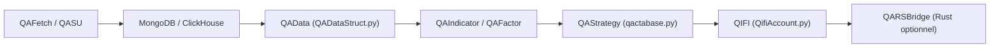

# yutiansut/QUANTAXIS

> Python quantitative finance framework for Chinese markets: data, backtesting, accounts, simulated or live trading.

## The problem
Assembling market data ingestion, storage, backtesting and multi-market account management yourself is a heavy undertaking.

## What it actually does
Python modules: data retrieval (QAFetch), saving to MongoDB or ClickHouse (QASU), market data structures, indicators, factors, CTA strategies, accounts in QIFI format, RabbitMQ bus and Tornado server. An optional Rust layer (QARS2) speeds up accounts and backtesting, with a fallback to Python. The README is in Chinese and the package is at `2.1.0-alpha2`.

## How it is wired


## Trying it
```bash
git clone https://github.com/QUANTAXIS/QUANTAXIS.git
cd QUANTAXIS
pip install -e .
pip install -e .[rust]
pip install -e .[full]
```

## Cost and gotchas
MongoDB 4.0+ or ClickHouse (optional), RabbitMQ for messaging, 8 GB of RAM recommended. The "100x" figures come from the README, with no measurement reproduced here.

## What it is not
Not a tool for Western markets: the adapters mainly target Chinese stocks and futures. Not a stable project: alpha, 240 open issues, dependencies of ~60 packages modernized all at once.

## Alternatives
No alternative named in the README.

## For you
Ignore unless you do quant work on Chinese markets: it is an alpha carried by a single person, and nothing in the README proves the reliability of the claimed figures.
