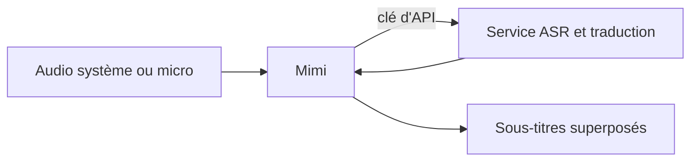

# yuxino/Mimi

> Desktop and Android application that displays real-time translated subtitles over your entire system.

## The problem
Live captioning software is paid or tied to a subscription.

## What it actually does
Captures system audio, an application's audio or the microphone, sends it to the service you configure (OpenAI, Gemini, xAI or others) and displays overlaid bilingual subtitles. An immersive mode lets you click through. Export to TXT, Markdown or WAV is manual. On an Apple Silicon Mac with macOS 26, a local service avoids the key.

## How it is wired
Simplified diagram based on the sheet, no diagram provided.

## Trying it
No documented command: download the installer for your platform, then "Settings, Models and services" to enter the key.

## Cost and gotchas
Free, but cloud services may bill and receive the audio or the recognized text. Platforms: macOS 13+, Windows x64, Linux x86_64, Android 10+.

## What it is not
It is not a standalone recognition engine: processing depends on the chosen provider. The README is in Chinese.

## Alternatives
Not documented in the README.

## For you
Watch: handy for following technical talks in a foreign language, but audio privacy depends on the chosen provider.
