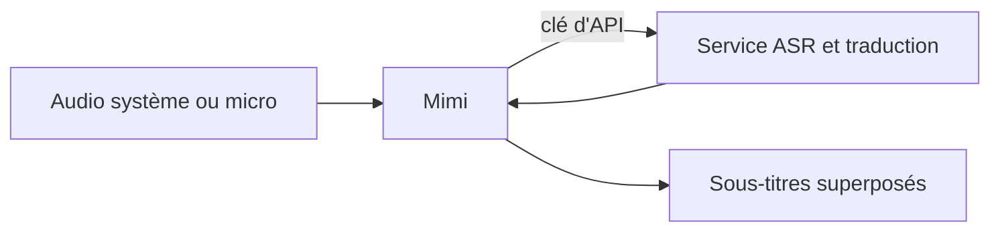

# yuxino/Mimi

> Application de bureau et Android qui affiche des sous-titres traduits en temps réel sur tout son système.

## Le problème
Les logiciels de sous-titrage en direct sont payants ou liés à un abonnement.

## Ce que ça fait vraiment
Capte le son du système, d'une application ou du micro, l'envoie au service que tu configures (OpenAI, Gemini, xAI ou autres) et affiche des sous-titres bilingues superposés. Un mode immersif laisse cliquer à travers. L'export TXT, Markdown ou WAV est manuel. Sur Mac Apple Silicon avec macOS 26, un service local évite la clé.

## Comment c'est branché
Schéma simplifié d'après la fiche, sans diagramme fourni.

## Essayer
Aucune commande documentée : télécharger l'installeur de ta plateforme, puis « Réglages, Modèles et services » pour saisir la clé.

## Coût et pièges
Gratuit, mais les services cloud peuvent facturer et reçoivent l'audio ou le texte reconnu. Plateformes : macOS 13+, Windows x64, Linux x86_64, Android 10+.

## Ce que ce n'est pas
Ce n'est pas un moteur de reconnaissance autonome : le traitement dépend du fournisseur choisi. Le README est en chinois.

## Alternatives
Non documenté dans le README.

## Pour toi
À surveiller : pratique pour suivre des conférences techniques en langue étrangère, mais la confidentialité de l'audio dépend du fournisseur retenu.

