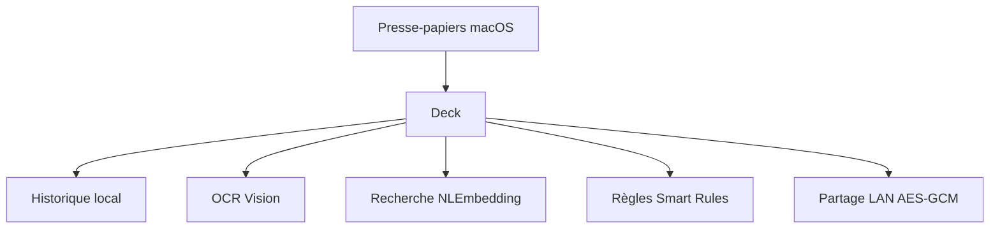

# yuzeguitarist/Deck

> Clipboard history manager for macOS, with semantic search, OCR and automatic rules.

## The problem
The macOS clipboard keeps only one item and cannot be searched.

## What it actually does
Deck records text, images, files, colors and links, with search by keyword, regular expression or semantics (NLEmbedding), background OCR (Vision), automatic rules with JavaScript scripts, templates and text transformations. It filters card numbers and sensitive windows, unlocks with Touch ID and shares over an AES-GCM-encrypted local network. Data stays on the Mac.

## How it is wired
Simplified diagram based on the sheet, no diagram provided.



## Trying it
```bash
brew tap yuzeguitarist/deck
export HOMEBREW_CASK_OPTS="--no-quarantine"
brew install --cask deckclip
```

## Cost and gotchas
macOS 14 or later. The app is not notarized, and the README asks not to download or update for now because of a packaging problem.

## What it is not
Not free software: outside the `deckclip/` folder (AGPL-3.0), the code is published for viewing only, with no right to use, modify or redistribute.

## Alternatives
Paste, Maccy and CopyClip, whose data Deck can migrate.

## For you
Ignore: a macOS clipboard app unrelated to data / AI / MLOps work, under a restrictive license and with a warning not to install it.
