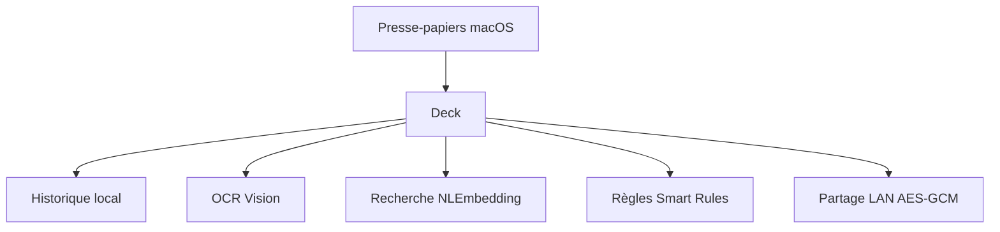

# yuzeguitarist/Deck

> Gestionnaire d'historique du presse-papiers pour macOS, avec recherche sémantique, OCR et règles automatiques.

## Le problème
Le presse-papiers macOS ne garde qu'un élément et ne se cherche pas.

## Ce que ça fait vraiment
Deck enregistre texte, images, fichiers, couleurs et liens, avec recherche par mot-clé, expression régulière ou sémantique (NLEmbedding), OCR en arrière-plan (Vision), règles automatiques avec scripts JavaScript, modèles et transformations de texte. Il filtre les numéros de carte et les fenêtres sensibles, se déverrouille par Touch ID et partage en réseau local chiffré en AES-GCM. Les données restent sur le Mac.

## Comment c'est branché
Schéma simplifié d'après la fiche, sans diagramme fourni.



## Essayer
```bash
brew tap yuzeguitarist/deck
export HOMEBREW_CASK_OPTS="--no-quarantine"
brew install --cask deckclip
```

## Coût et pièges
macOS 14 ou plus. L'application n'est pas notarisée, et le README demande de ne pas télécharger ni mettre à jour pour l'instant à cause d'un problème d'empaquetage.

## Ce que ce n'est pas
Pas un logiciel libre : hors du dossier `deckclip/` (AGPL-3.0), le code est publié pour consultation seulement, sans droit d'usage, de modification ni de redistribution.

## Alternatives
Paste, Maccy et CopyClip, dont Deck sait migrer les données.

## Pour toi
À ignorer : application macOS pour le presse-papiers sans lien avec le travail data / IA / MLOps, sous licence restrictive et avec un avertissement de ne pas l'installer.

