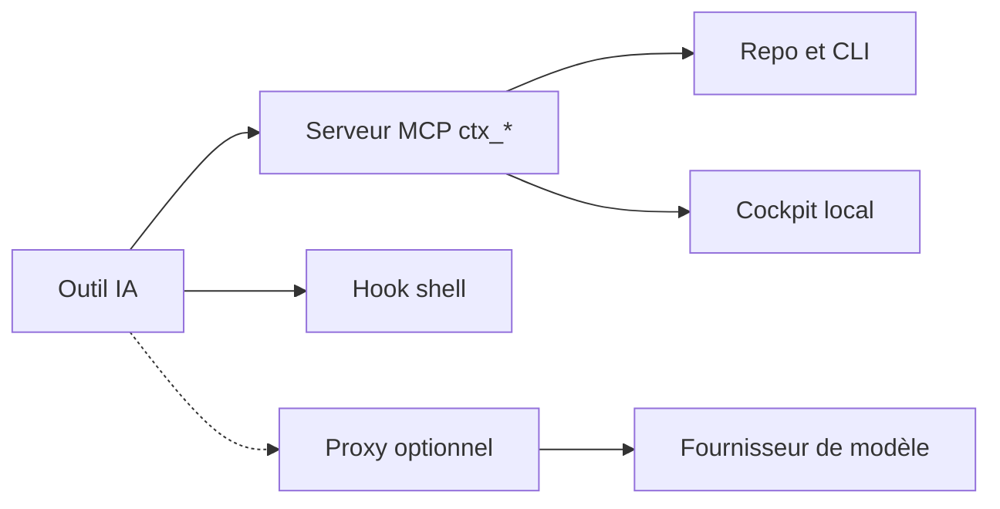

# yvgude/lean-ctx

> Context gateway between coding agents and projects: compresses reads and shell output, for Claude Code, Cursor or Codex users.

## The problem
Agents re-read the same files and swallow noisy shell output, which wastes the context window and tokens.

## What it actually does
Plugs in as an MCP server, shell hook and optional proxy. Offers sixteen file-reading modes, 85 shell-output compression patterns and Tree-sitter analysis for 27 languages. Keeps session memory, a knowledge graph and a savings log (cockpit, `gain`, estimated Shadow mode). Several features are declared experimental (addons, snapshots, packages).

## How it is wired
Simplified diagram based on the fiche, no diagram supplied.


## Trying it
```bash
curl -fsSL https://leanctx.com/install.sh | sh
lean-ctx wrap cursor      # ou : wrap claude / wrap codex
lean-ctx doctor
lean-ctx gain --terminal
```

## Cost and gotchas
Free locally; the publisher also mentions Enterprise and SDK offerings under separate licenses. The gain depends on session length and the provider's cache price; the README admits a break-even point in some cases. With a Claude Pro/Max subscription, request-level compression is not available.

## What it is not
Not a model nor a guarantee of answer quality: the savings are simulated estimates. The README is truncated before the benchmark figures; old figures have been removed.

## Alternatives
No alternative named in the README.

## For you
Worth watching: useful if you pay for tokens on large repositories with a coding agent; measure it on your own repository with `lean-ctx benchmark report .`.
