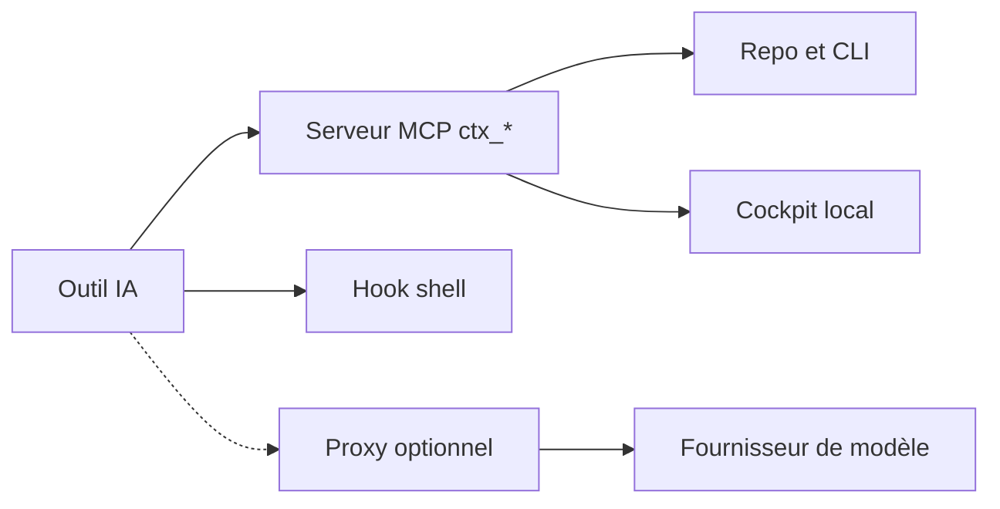

# yvgude/lean-ctx

> Passerelle de contexte entre agents de code et projets : compresse lectures et sorties shell, pour utilisateurs de Claude Code, Cursor ou Codex.

## Le problème
Les agents relisent les mêmes fichiers et avalent des sorties shell bruyantes, ce qui gaspille la fenêtre de contexte et les tokens.

## Ce que ça fait vraiment
S'insère comme serveur MCP, hook shell et proxy optionnel. Propose seize modes de lecture de fichiers, 85 motifs de compression de sorties shell et une analyse Tree-sitter pour 27 langages. Garde une mémoire de session, un graphe de connaissances et un journal d'économies (cockpit, `gain`, mode Shadow estimé). Plusieurs fonctions sont déclarées expérimentales (addons, snapshots, packages).

## Comment c'est branché
Schéma simplifié d'après la fiche, sans diagramme fourni.


## Essayer
```bash
curl -fsSL https://leanctx.com/install.sh | sh
lean-ctx wrap cursor      # ou : wrap claude / wrap codex
lean-ctx doctor
lean-ctx gain --terminal
```

## Coût et pièges
Gratuit en local ; l'éditeur parle aussi d'offres Enterprise et SDK sous licences séparées. Le gain dépend de la durée de session et du prix du cache du fournisseur ; le README admet un point mort dans certains cas. Avec un abonnement Claude Pro/Max, la compression au niveau requête n'est pas disponible.

## Ce que ce n'est pas
Pas un modèle ni une garantie de qualité de réponse : les économies sont des estimations simulées. Le README est tronqué avant les chiffres de benchmark ; les anciens chiffres sont retirés.

## Alternatives
Aucune alternative nommée dans le README.

## Pour toi
À surveiller : utile si tu paies des tokens sur de gros dépôts avec un agent de code ; à mesurer sur ton propre dépôt avec `lean-ctx benchmark report .`.

