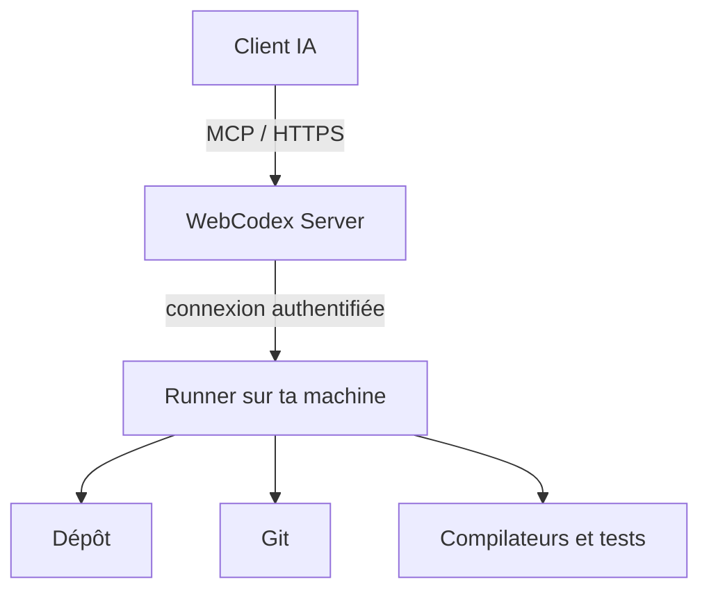

# yyjeqhc/webcodex

> Self-hosted tool runtime: an AI assistant acts on your local repository through a Server and a Runner.

## The problem
An online AI assistant cannot see your code or your tools. Copying it into a hosted space is heavy and exposes your files.

## What it actually does
A Server authenticates the MCP/HTTPS requests of an AI client and routes them to a Runner on the machine that owns the repository. The assistant reads, searches, edits, runs tests and commands, and uses Git. Long tasks remain observable (console, sessions, jobs). Requested file excerpts may be returned to the AI client.

## How it is wired


## Trying it
```bash
cargo build --locked --profile dogfood --workspace --bins
```
The README also mentions `webcodex share` for a temporary trial of a repository, without detailing the command here.

## Cost and gotchas
Free, Apache-2.0. The installers (Windows, macOS, .deb) are not yet validated on all three platforms. Building from source: stable Rust, Node.js 22 for the desktop app.

## What it is not
Not an AI assistant: you need an AI client (ChatGPT, Claude...). Not a hosted service. It can modify files and run commands: restrict the project roots.

## Alternatives
No alternative named in the README.

## For you
Worth watching: the idea of keeping code local while opening it to an agent is useful in MLOps, but the installation is not yet validated.
