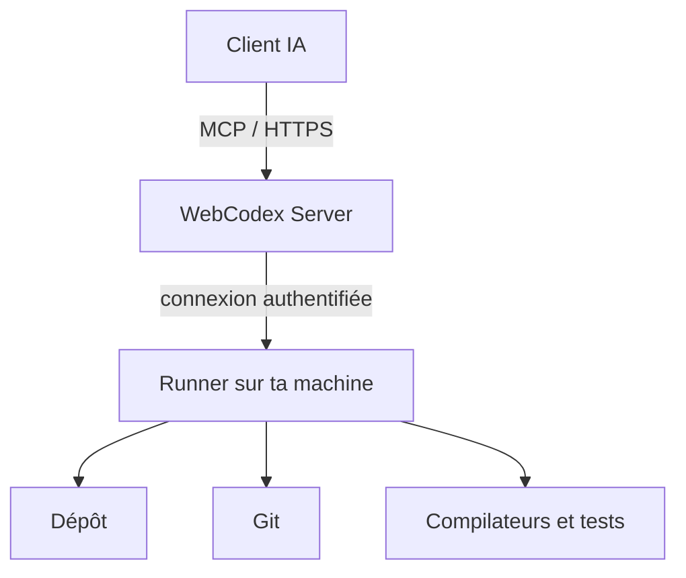

# yyjeqhc/webcodex

> Runtime d'outils auto-hébergé : un assistant IA agit sur ton dépôt local via un Server et un Runner.

## Le problème
Un assistant IA en ligne ne voit pas ton code ni tes outils. Le copier dans un espace hébergé est lourd et expose les fichiers.

## Ce que ça fait vraiment
Un Server authentifie les requêtes MCP/HTTPS d'un client IA et les route vers un Runner sur la machine qui possède le dépôt. L'assistant lit, cherche, modifie, lance tests et commandes, utilise Git. Les tâches longues restent observables (console, sessions, jobs). Des extraits de fichiers demandés peuvent revenir au client IA.

## Comment c'est branché


## Essayer
```bash
cargo build --locked --profile dogfood --workspace --bins
```
Le README mentionne aussi `webcodex share` pour un essai temporaire d'un dépôt, sans détailler la commande ici.

## Coût et pièges
Gratuit, Apache-2.0. Les installateurs (Windows, macOS, .deb) ne sont pas encore validés sur les trois plateformes. Compilation depuis les sources : Rust stable, Node.js 22 pour le bureau.

## Ce que ce n'est pas
Pas un assistant IA : il faut un client IA (ChatGPT, Claude...). Pas un service hébergé. Il peut modifier des fichiers et exécuter des commandes : limite les racines de projet.

## Alternatives
Aucune alternative nommée dans le README.

## Pour toi
À surveiller : l'idée de garder le code en local tout en l'ouvrant à un agent est utile en MLOps, mais l'installation n'est pas encore validée.

