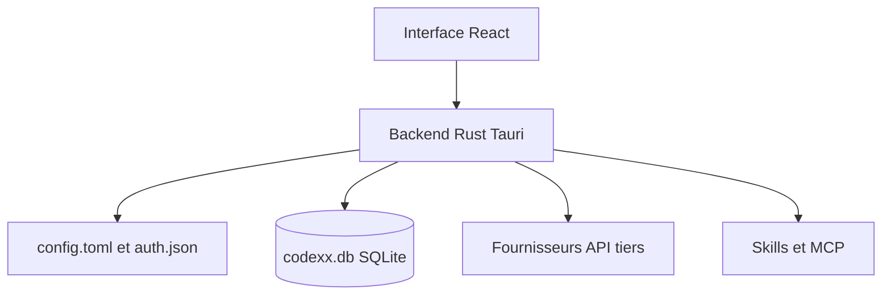

# yynxxxxx/Codex-X

> Desktop application to manage Codex prompts, API providers, sessions, Skills and MCP.

## The problem
With Codex on desktop and CLI, configuration is scattered across `config.toml`, `auth.json` and several sets of prompts.

## What it actually does
Tauri 2 interface (React, Rust, SQLite): activation of prompt templates, including so-called "unrestricted" prompts meant to bypass the model's safeguards, management of third-party providers and official connections, synchronization and deletion of sessions, management of Skills and MCP, token statistics. README written in Chinese.

## How it is wired
Simplified diagram based on the fiche, no diagram provided.



## Trying it
```bash
pnpm install
pnpm dev
pnpm --dir apps/desktop tauri build
```

## Cost and gotchas
Free, but third-party provider API keys are entered and stored in the tool. Unsigned macOS DMGs trigger Gatekeeper. Deleting sessions is irreversible.

## What it is not
Not an official OpenAI tool. Its "unrestricted" prompt templates amount to bypassing safeguards, which raises usage risks.

## Alternatives
`cc-switch`: the README lets you import its existing providers.

## For you
Ignore: young tool from a single maintainer, focused on bypassing safeguards and managing API proxies, poorly suited to professional use.
