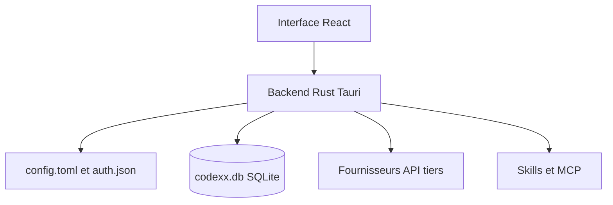

# yynxxxxx/Codex-X

> Application de bureau pour gérer prompts, fournisseurs d'API, sessions, Skills et MCP de Codex.

## Le problème
Avec Codex en bureau et en CLI, la configuration est dispersée entre `config.toml`, `auth.json` et plusieurs jeux de prompts.

## Ce que ça fait vraiment
Interface Tauri 2 (React, Rust, SQLite) : activation de modèles de prompts, dont des prompts dits « sans restriction » visant à contourner les garde-fous du modèle, gestion de fournisseurs tiers et de connexions officielles, synchronisation et suppression des sessions, gestion des Skills et MCP, statistiques de tokens. README rédigé en chinois.

## Comment c'est branché
Schéma simplifié d'après la fiche, sans diagramme fourni.



## Essayer
```bash
pnpm install
pnpm dev
pnpm --dir apps/desktop tauri build
```

## Coût et pièges
Gratuit, mais les clés d'API de fournisseurs tiers sont saisies et stockées dans l'outil. Les DMG macOS non signés déclenchent Gatekeeper. La suppression de sessions est irréversible.

## Ce que ce n'est pas
Ce n'est pas un outil officiel d'OpenAI. Ses modèles de prompts « sans restriction » relèvent du contournement de garde-fous, ce qui pose des risques d'usage.

## Alternatives
`cc-switch` : le README permet d'en importer les fournisseurs existants.

## Pour toi
Ignorer : outil jeune d'un seul mainteneur, centré sur le contournement de garde-fous et la gestion de proxys d'API, peu adapté à un usage professionnel.

