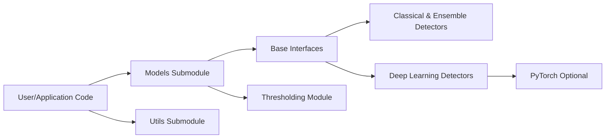

# yzhao062/pyod

> Python anomaly detection library: 61 detectors for tabular data, time series, graphs, text, audio.

## The problem
Each anomaly detection method has its own implementation and API; comparing and choosing a detector takes time.

## What it actually does
Single `fit` / `decision_function` / `predict` / `predict_proba` API for IForest, ECOD, LOF, AutoEncoder, DeepSVDD…
Time series (KShape, MatrixProfile, LSTMAD), PyG graphs (DOMINANT, CoLA), audio, text/image via `EmbeddingOD`.
`ADEngine` selects, compares and evaluates detectors; `od-expert` skill for Claude Code/Codex and a 10-tool MCP server.
SUOD and numba acceleration; synthetic data and evaluation utilities (ROC, P@n).

## How it is wired


## Trying it
```bash
pip install pyod
pyod install skill
pip install pyod[mcp]
pyod mcp serve
pyod info
```

## Cost and gotchas
Free, BSD-2. The graph/audio/MCP extras are optional; `OpenAIEncoder` implies an API key at your expense. Graph and MatrixProfile detectors are transductive (no out-of-sample `predict`).

## What it is not
Not a monitoring service nor an alerting system: a library. The stateful MCP tools (`investigate`) are deferred.

## Alternatives
- PyGOD: dedicated to graphs.
- TODS: dedicated to time series.
- ADBench: for benchmarking rather than detecting.

## For you
Adopt: the reference for anomaly detection in Python, familiar scikit-learn API, and ADEngine speeds up the choice of detector on a new dataset.
