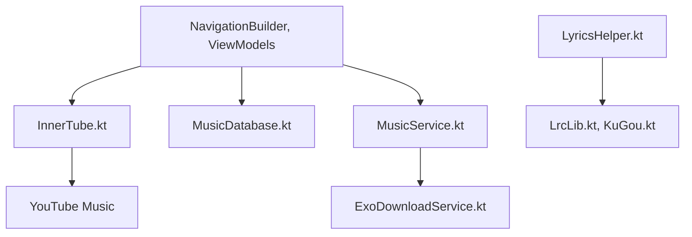

# z-huang/InnerTune

> Material 3 Android client for YouTube Music, with background playback and no ads.

## The problem
The official app imposes ads, offline limits and paid features.

## What it actually does
Multi-module Kotlin/Compose app: an innertube module talks to the YouTube Music API, MusicService handles playback and the queue, and a Room database stores the library and history. Lyrics via LrcLib and KuGou, Discord Rich Presence via a kizzy module, Android Auto, offline download.

## How it is wired


## Trying it
```bash
# Aucune commande dans le README : appli Android, installation par APK ou
# compilation Gradle, non détaillée.
```

## Cost and gotchas
Free. Unusable in a region without YouTube Music unless you use a proxy or VPN. Android Auto requires enabling "unknown sources".

## What it is not
Not affiliated with YouTube or Google (explicit clause). Relies on an unofficial API that can change without notice. No built-in scrobbling.

## Alternatives
ViMusic (vfsfitvnm), cited as a source of inspiration, not as a replacement.

## For you
Ignore: consumer Android app with no link to data or AI.
