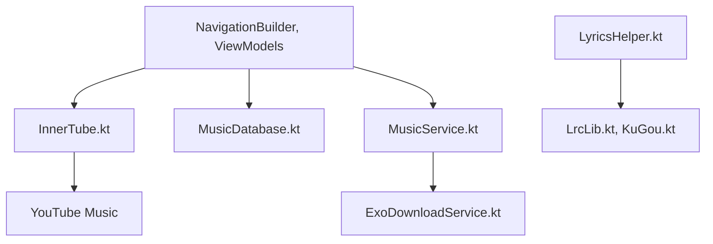

# z-huang/InnerTune

> Client Android Material 3 pour YouTube Music, avec lecture en arrière-plan et sans publicités.

## Le problème
L'appli officielle impose publicités, limites hors ligne et fonctions payantes.

## Ce que ça fait vraiment
Appli Kotlin/Compose multi-modules : un module innertube parle à l'API de YouTube Music, MusicService gère la lecture et la file, une base Room stocke bibliothèque et historique. Paroles via LrcLib et KuGou, Discord Rich Presence via un module kizzy, Android Auto, téléchargement hors ligne.

## Comment c'est branché


## Essayer
```bash
# Aucune commande dans le README : appli Android, installation par APK ou
# compilation Gradle, non détaillée.
```

## Coût et pièges
Gratuit. Inutilisable dans une région sans YouTube Music sans proxy ou VPN. Android Auto demande d'activer les « sources inconnues ».

## Ce que ce n'est pas
Pas affilié à YouTube ni à Google (clause explicite). S'appuie sur une API non officielle qui peut changer sans préavis. Pas de scrobbling intégré.

## Alternatives
ViMusic (vfsfitvnm), cité comme source d'inspiration, pas comme remplaçant.

## Pour toi
À ignorer : appli grand public Android sans lien avec la data ou l'IA.

