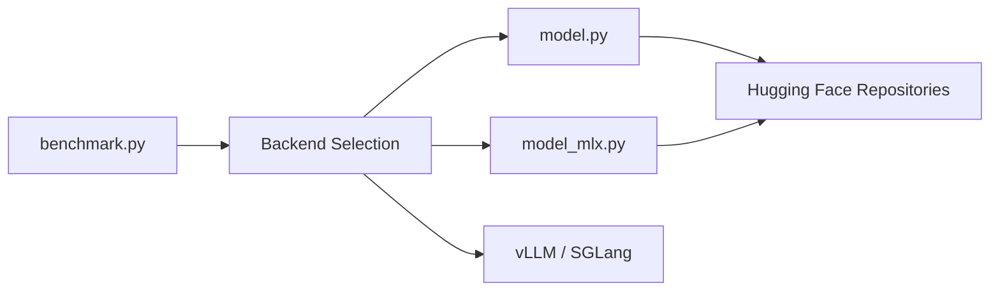

# z-lab/dflash

> Block-diffusion draft models to speed up speculative decoding of LLMs.

## The problem
Autoregressive generation produces one token at a time; classic speculative decoding drafts remain sequential and limit the gain.

## What it actually does
A small model proposes a block of tokens in parallel, the target model verifies it and keeps the accepted tokens.
Public checkpoints for Qwen3.x, Gemma 4, Kimi, GPT-OSS, Llama-3.1-8B, etc.
Local backends Transformers (Linux) and MLX (Apple Silicon); otherwise through an OpenAI-compatible vLLM or SGLang server.
Common benchmark CLI (gsm8k, math500, humaneval, mbpp, mt-bench).

## How it is wired


## Trying it
```bash
pip install dflash
pip install "dflash[local]"
dflash generate openai --base-url http://127.0.0.1:8000 --model Qwen/Qwen3.8-27B "How many positive whole-number divisors does 196 have?"
dflash benchmark openai --base-url http://127.0.0.1:8000 --model Qwen/Qwen3.8-27B --dataset gsm8k --num-prompts 128
```

## Cost and gotchas
Free, but targets range from 27B to 397B: a big GPU or a well-equipped Mac. The vLLM/SGLang server is installed separately.

## What it is not
Not an inference server: the repository provides only the draft model and the benchmark harness. Each target model requires its own dedicated checkpoint.

## Alternatives
No alternative named in the README (vLLM, SGLang, llama.cpp are hosts, not competitors).

## For you
Worth watching: if you serve open LLMs on vLLM, it is a potential latency lever to measure on your model before believing in it.
