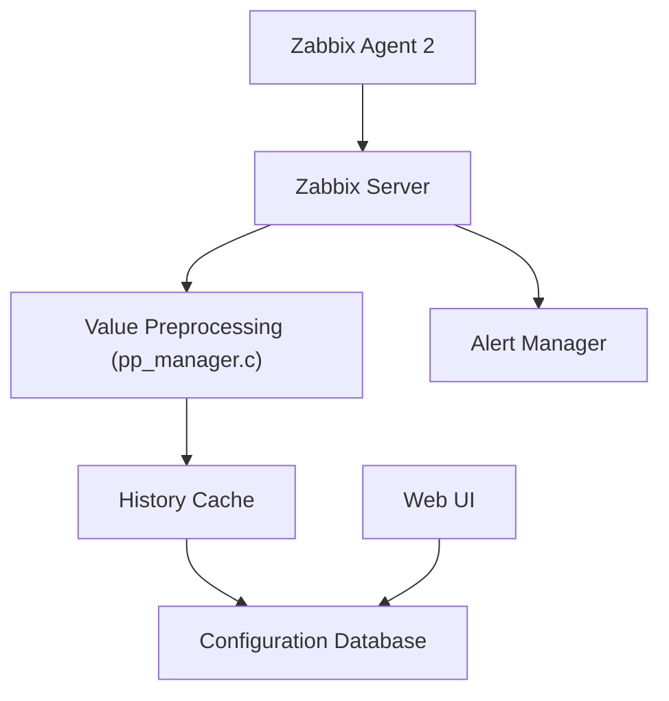

# zabbix/zabbix

> Open source distributed monitoring platform for watching servers, networks and services.

## The problem
Without centralized monitoring, you discover outages and saturation of servers, networks and services too late.

## What it actually does
Collects metrics via agents or agentless, resource discovery, value preprocessing, expression evaluation and event correlation. Sends alerts (Slack, Jira, Teams, email) and produces reports. Web interface, distributed monitoring, high availability, audit log, ClickHouse history storage.

## How it is wired
Diagram taken from the code, simplified.



## Trying it
No command in the README; it points to the installation manual and the documentation.

```bash
# non documenté dans le README : voir le manuel d'installation
```

## Cost and gotchas
Free, but you need a database, a server and agents to operate. AGPL-3.0 license: obligations if you offer the modified software as a service.

## What it is not
Not an observability tool for ML models in particular: it is general-purpose infrastructure monitoring.

## Alternatives
No alternative named in the README.

## For you
Watch: useful for monitoring the infrastructure under your pipelines and models, but heavy to operate for a small project.
