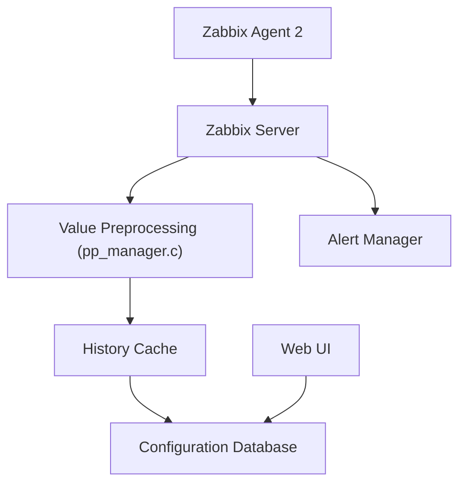

# zabbix/zabbix

> Plateforme de supervision distribuée open source pour surveiller serveurs, réseaux et services.

## Le problème
Sans supervision centralisée, on découvre les pannes et la saturation de serveurs, réseaux et services trop tard.

## Ce que ça fait vraiment
Collecte des métriques via agents ou sans agent, découverte de ressources, prétraitement des valeurs, évaluation d'expressions et corrélation d'événements. Envoie des alertes (Slack, Jira, Teams, email) et produit des rapports. Interface web, supervision distribuée, haute disponibilité, journal d'audit, stockage historique ClickHouse.

## Comment c'est branché
Diagramme tiré du code, simplifié.



## Essayer
Aucune commande dans le README ; il renvoie au manuel d'installation et à la documentation.

```bash
# non documenté dans le README : voir le manuel d'installation
```

## Coût et pièges
Gratuit, mais il faut une base de données, un serveur et des agents à exploiter. Licence AGPL-3.0 : obligations si tu proposes le logiciel modifié en service.

## Ce que ce n'est pas
Pas un outil d'observabilité pour modèles ML en particulier : c'est de la supervision d'infrastructure généraliste.

## Alternatives
Aucune alternative nommée dans le README.

## Pour toi
À surveiller : utile pour superviser l'infrastructure sous tes pipelines et modèles, mais lourd à exploiter pour un petit projet.

