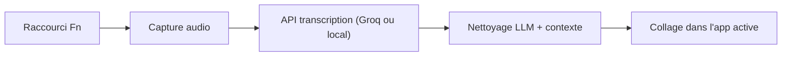

# zachlatta/freeflow

> Dictée vocale pour Mac avec nettoyage par LLM, alternative gratuite à Wispr Flow, pour qui dicte beaucoup.

## Le problème
Les outils de dictée comme Wispr Flow ou Superwhisper sont payants par abonnement.

## Ce que ça fait vraiment
Tu maintiens `Fn` pour parler, le texte est transcrit puis nettoyé, et collé dans le champ actif. Le nettoyage peut lire le contexte voisin pour orthographier noms et termes ; un vocabulaire personnalisé et un « mode édition » (reformuler une sélection à la voix) existent. Groq par défaut, ou tout fournisseur compatible OpenAI, y compris local (Ollama, LM Studio).

## Comment c'est branché


## Essayer
```bash
defaults write com.zachlatta.freeflow transcription_timeout_seconds -float 120
```
Installation : télécharger l'app, créer une clé Groq gratuite sur groq.com.

## Coût et pièges
Clé Groq gratuite ou ton fournisseur. Audio et contexte partent vers ce fournisseur (aucun serveur FreeFlow). Délai par défaut 20 s, trop court pour un modèle local.

## Ce que ce n'est pas
Pas hors ligne par défaut : sans modèle local configuré, tout passe par l'API. Le README ne parle pas de licence tierce du fournisseur.

## Alternatives
Wispr Flow, Superwhisper, Monologue : cités comme les outils payants que FreeFlow remplace.

## Pour toi
À surveiller : pratique pour dicter tes notes, à n'utiliser avec un modèle local que si la confidentialité compte.

