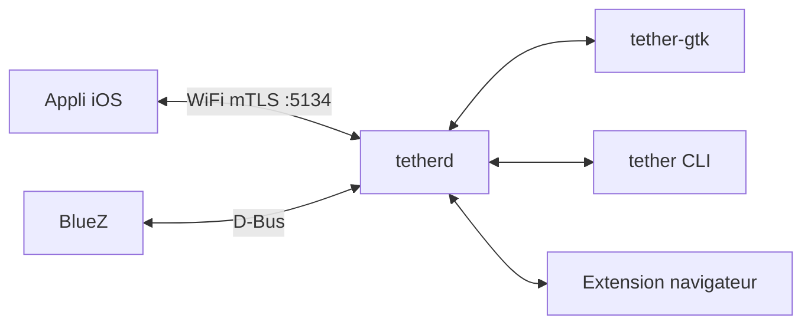

# zackb/tether

> Bridge between an iPhone and a Linux Wayland desktop to recover Apple's Continuity features.

## The problem
Leaving macOS while keeping an iPhone means losing shared clipboard, file transfer, messages and notifications.

## What it actually does
A `tetherd` daemon talks to the iPhone over WiFi (mutual TLS, port 5134, mDNS) and over Bluetooth. It offers clipboard sync, file transfer, SMS/iMessage messages, notification mirroring, calls and OTP codes, with an iOS app, GTK interface, TUI, CLI and browser and Thunderbird extensions.

## How it is wired


## Trying it
```bash
yay -S tether
tether pending
tether accept <fingerprint>
tether bt setup
```

## Cost and gotchas
Free, but you need an iPhone, a Wayland compositor with `wlr-data-control` and, for notifications, a compatible Bluetooth BR/EDR adapter (some dongles do not work). BlueZ 5.86 minimum.

## What it is not
It is not a data tool: it only serves to link an iPhone to Linux. Notifications do not work with iOS 18 or earlier. Calls and camera are in beta or alpha.

## Alternatives
No alternative named in the README.

## For you
Ignore: a personal convenience utility unrelated to data, AI or MLOps.
