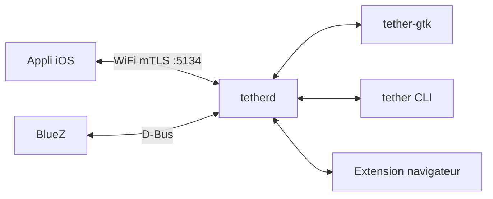

# zackb/tether

> Pont entre un iPhone et un bureau Linux Wayland pour reprendre les fonctions Continuity d'Apple.

## Le problème
Quitter macOS en gardant un iPhone fait perdre presse-papiers partagé, transfert de fichiers, messages et notifications.

## Ce que ça fait vraiment
Un démon `tetherd` parle à l'iPhone par WiFi (TLS mutuel, port 5134, mDNS) et par Bluetooth. Il propose synchronisation du presse-papiers, transfert de fichiers, messages SMS/iMessage, miroir de notifications, appels et codes OTP, avec appli iOS, interface GTK, TUI, CLI et extensions navigateur et Thunderbird.

## Comment c'est branché


## Essayer
```bash
yay -S tether
tether pending
tether accept <fingerprint>
tether bt setup
```

## Coût et pièges
Gratuit, mais il faut un iPhone, un compositeur Wayland avec `wlr-data-control` et, pour les notifications, un adaptateur Bluetooth BR/EDR compatible (certains dongles ne marchent pas). BlueZ 5.86 minimum.

## Ce que ce n'est pas
Ce n'est pas un outil de data : il ne sert qu'à lier un iPhone à Linux. Les notifications ne marchent pas avec iOS 18 ou antérieur. Les appels et la caméra sont en bêta ou alpha.

## Alternatives
Aucune alternative nommée dans le README.

## Pour toi
À ignorer : utilitaire de confort personnel sans rapport avec la data, l'IA ou le MLOps.

