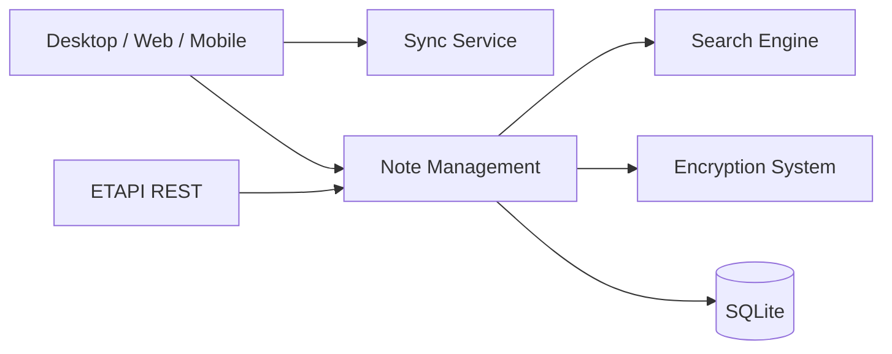

# zadam/trilium

> Self-hostable hierarchical note-taking application for building large personal knowledge bases.

## The problem
Flat notes cannot hold tens of thousands of entries; SaaS tools lock in the data.

## What it actually does
Tree-structured notes (a note can be cloned in several places), WYSIWYG editor, code notes, versioning, attributes for querying and scripting, per-note encryption, synchronization with a self-hosted server, REST API, public sharing, Excalidraw canvas, mind maps and geo maps. The README states it holds beyond 100,000 notes. The repository was handed over to the TriliumNext community; the README is that of this successor.

## How it is wired


## Trying it
```bash
git clone https://github.com/TriliumNext/Trilium.git
cd Trilium
pnpm install
pnpm run server:start
```
(user installation: binary from the releases page, to unpack then run `trilium`.)

## Cost and gotchas
Free. After v0.90.4, synchronization is no longer compatible with zadam/trilium v0.63.7; mobile clients must have the same sync version as the server.

## What it is not
Not a pure Markdown editor nor a real-time collaborative tool (not documented). There is no official mobile app: those are third-party projects.

## Alternatives
TriliumNext/Trilium (active successor); the README cites Evernote, OneNote, Google Keep, Notion, Obsidian and Anytype as import sources.

## For you
To adopt for a self-hosted personal knowledge base; know the AGPL license if you want to modify and expose it.
