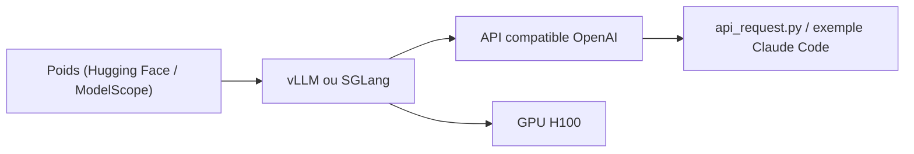

# zai-org/GLM-4.5

> Zhipu (Z.ai) GLM-4.5 to 4.7 models: open weights, serving code and inference examples.

## The problem
Serving large reasoning and agent models locally, with tool calling and a thinking mode.

## What it actually does
The repository presents the GLM-4.7, 4.6 and 4.5 family (355B-A32B, Air 106B-A12B, Flash 30B-A3B), download links (Hugging Face, ModelScope), minimum GPU configurations and serving commands with vLLM and SGLang (tool and reasoning parsers, speculative decoding). It contains inference scripts (`trans_infer_cli.py`, `api_request.py`) and a Claude Code example.

## How it is wired


## Trying it
```bash
vllm serve zai-org/GLM-4.7-FP8 \
     --tensor-parallel-size 4 \
     --speculative-config.method mtp \
     --speculative-config.num_speculative_tokens 1 \
     --tool-call-parser glm47 \
     --reasoning-parser glm45 \
     --enable-auto-tool-choice \
     --served-model-name glm-4.7-fp8
```

## Cost and gotchas
Heavy hardware: GLM-4.5 in FP8 requires 8 H100s and more than 1 TB of server RAM; only GLM-4.7-Flash fits on 1 H100 in BF16. "Preserved Thinking" mode is supported by SGLang only.

## What it is not
Not the full training code: it is an inference and documentation repository. The benchmark figures come from the authors.

## Alternatives
No alternative named in the README (the hosted Z.ai API is cited).

## For you
Worth watching: GLM-4.7-Flash is the realistic entry point for a local trial; the large models exceed the budget of a team without a cluster.
