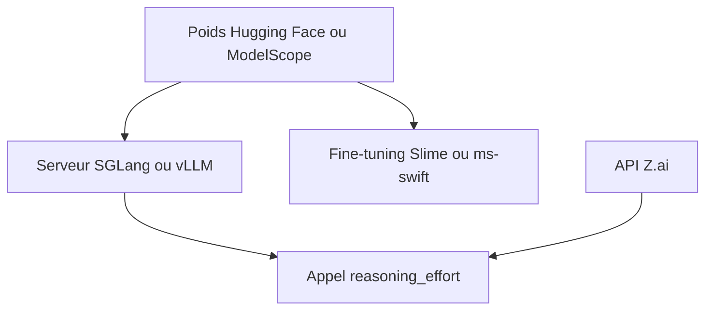

# zai-org/GLM-5

> Family of open-weight language models (GLM-5 to 5.3) oriented toward code and long tasks.

## The problem
Open models still lag behind closed models on code and long-horizon agent tasks.

## What it actually does
The repository is a presentation and links page: weights on Hugging Face and ModelScope, sizes 744B-A40B (GLM-5.x) and 320B-A18B (GLM-5.3-Flash), in FP8 and BF16. It explains how to serve through SGLang, vLLM, Transformers, KTransformers, Unsloth, and how to fine-tune via Slime or ms-swift. The figures reported are the publisher's own.

## How it is wired

Diagram not provided: simplified from the README.

## Trying it
```bash
# Aucune commande dans le README : télécharger les poids depuis Hugging Face ou ModelScope,
# puis suivre les cookbooks SGLang ou vLLM.
```

## Cost and gotchas
Considerable hardware needed to self-host these sizes. Paid API on Z.ai. For GLM-5.3, `reasoning_effort` defaults to `max` and `clear_thinking` defaults to `false`.

## What it is not
Not training or inference code: it is a documentation repository. The benchmarks come from the publisher.

## Alternatives
No alternative named in the README.

## For you
Worth watching: a useful open-weights reference, but unusable without a large cluster; go through the API to test.
