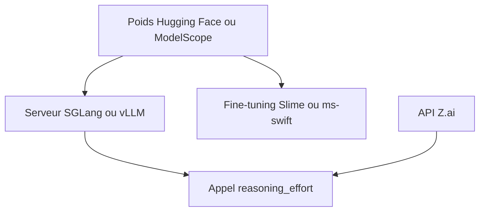

# zai-org/GLM-5

> Famille de modèles de langage à poids ouverts (GLM-5 à 5.3) orientée code et tâches longues.

## Le problème
Les modèles ouverts restent en retrait des modèles fermés sur le code et les tâches d'agent à long horizon.

## Ce que ça fait vraiment
Le dépôt est une page de présentation et de liens : poids sur Hugging Face et ModelScope, tailles 744B-A40B (GLM-5.x) et 320B-A18B (GLM-5.3-Flash), en FP8 et BF16. Il indique comment servir via SGLang, vLLM, Transformers, KTransformers, Unsloth, et affiner via Slime ou ms-swift. Les résultats chiffrés sont ceux de l'éditeur.

## Comment c'est branché

Schéma non fourni : diagramme simplifié d'après le README.

## Essayer
```bash
# Aucune commande dans le README : télécharger les poids depuis Hugging Face ou ModelScope,
# puis suivre les cookbooks SGLang ou vLLM.
```

## Coût et pièges
Matériel considérable pour auto-héberger ces tailles. API payante sur Z.ai. Pour GLM-5.3, `reasoning_effort` vaut `max` par défaut et `clear_thinking` vaut `false`.

## Ce que ce n'est pas
Pas un code d'entraînement ni d'inférence : c'est un dépôt de documentation. Les benchmarks viennent de l'éditeur.

## Alternatives
Aucune alternative nommée dans le README.

## Pour toi
À surveiller : référence utile pour l'open-weights, mais inutilisable sans gros cluster ; passer par l'API pour tester.

