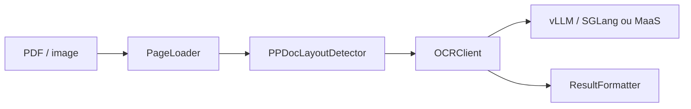

# zai-org/GLM-OCR

> 0.9-billion-parameter OCR model and SDK for reading complex documents.

## The problem
Extract text, tables and formulas from real-world documents with a lightweight, deployable model.

## What it actually does
Two-stage pipeline: layout detection (PP-DocLayout-V3) then parallel recognition, with Markdown or JSON output. Python SDK and CLI, Flask service, deployment via vLLM, SGLang, Ollama or MLX. The README claims 94.62 on OmniDocBench V1.5 (the authors' own measurement). Cloud MaaS mode from Zhipu, no GPU needed.

## How it is wired


## Trying it
```bash
pip install glmocr
pip install "glmocr[selfhosted]"
glmocr parse examples/source/code.png
python -m glmocr.server
```

## Cost and gotchas
MaaS mode requires a key from open.bigmodel.cn (billing not detailed). Self-hosting assumes a GPU and vLLM >= 0.19 or SGLang >= 0.5.10.

## What it is not
Does not replace human verification of critical extractions.

## Alternatives
No alternative named in the README.

## For you
Adopt: lightweight document OCR, deployable locally, relevant for RAG and extraction pipelines; test it on your own documents.
