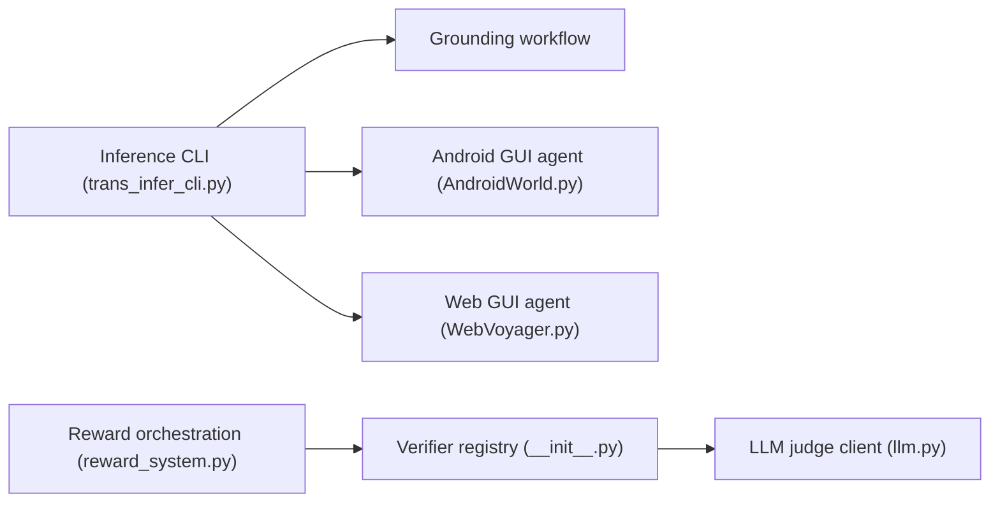

# zai-org/GLM-V

> Open vision-language models GLM-4.6V, 4.5V and 4.1V, with GUI agent and grounding examples.

## The problem
Open multimodal models reason poorly on long documents, interfaces and precise object localization.

## What it actually does
The repository gathers links to the models (GLM-4.6V at 106B, 4.6V-Flash at 9B, 4.5V, 4.1V-9B-Thinking), grounding and GUI agent documentation, a desktop application, a verifier-based reward system and skills (PDF to slides or web, image capture, résumé screening). The model implementation lives in Transformers. Deployment via SGLang, vLLM or Transformers.

## How it is wired

## Trying it
No installation command in the README. Deployment via SGLang, vLLM or Transformers: see the cited recipes.

## Cost and gotchas
A GPU is required for the large models; GGUF versions are available on Hugging Face for reduced sizes. Acknowledged limits: repetitive thinking, text QA to be improved, imperfect counting and identification.

## What it is not
Not the model code: it lives in Transformers. The benchmark figures are the authors' own.

## Alternatives
- Qwen-2.5-VL-72B: cited as a model outperformed on 18 tasks.

## For you
Worth watching: an open VLM family under Apache-2.0 with standard deployment; compare it on your own data.
