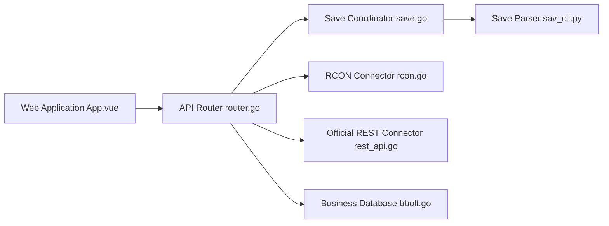

# zaigie/palworld-server-tool

> Web interface and REST API for managing a Palworld dedicated server (players, saves, RCON).

## The problem
Administering a Palworld server by hand (players, guilds, saves, commands) is tedious without a dashboard.

## What it actually does
A Go backend parses `Level.sav` through a Python tool (`sav_cli`), queries the official REST API and RCON, and exposes players, guilds, Pals, inventories, metrics, kick, ban, broadcast, whitelist, map, scheduled RCON commands and automatic saves. A Vue interface for desktop and mobile. A `pst-agent` agent retrieves saves from another host.

## How it is wired


## Trying it
```bash
touch pst.db config.db
docker run -d --name pst -p 8080:8080 -v /path/to/your/Pal/Saved:/game -v ./backups:/app/backups -v ./pst.db:/app/pst.db -v ./config.db:/app/config.db jokerwho/palworld-server-tool:latest
./pst --port 18080
```

## Cost and gotchas
Free; parsing `Level.sav` takes about 1 to 3 GB of memory. The first visitor becomes administrator: set the password right away, or delete `config.db` to start over. The old `config.yaml` is no longer read.

## What it is not
Not a general game administration tool: it targets Palworld only. The password protects the dashboard, not the game server's `AdminPassword`. The README asks that the author be informed of any commercial use.

## Alternatives
No alternative named in the README.

## For you
Ignore: niche tool for one specific game, unrelated to data/AI work; useful only if you host a Palworld server.
