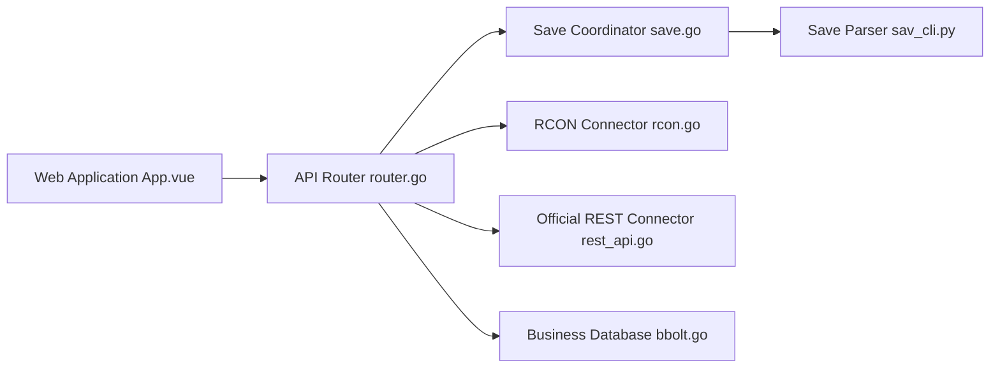

# zaigie/palworld-server-tool

> Interface web et API REST pour gérer un serveur dédié Palworld (joueurs, sauvegardes, RCON).

## Le problème
Administrer un serveur Palworld à la main (joueurs, guildes, sauvegardes, commandes) est fastidieux sans tableau de bord.

## Ce que ça fait vraiment
Un backend Go analyse `Level.sav` via un outil Python (`sav_cli`), interroge l'API REST officielle et RCON, et expose joueurs, guildes, Pals, inventaires, métriques, kick, ban, diffusion, liste blanche, carte, commandes RCON planifiées et sauvegardes automatiques. Une interface Vue pour bureau et mobile. Un agent `pst-agent` récupère les sauvegardes sur un autre hôte.

## Comment c'est branché


## Essayer
```bash
touch pst.db config.db
docker run -d --name pst -p 8080:8080 -v /path/to/your/Pal/Saved:/game -v ./backups:/app/backups -v ./pst.db:/app/pst.db -v ./config.db:/app/config.db jokerwho/palworld-server-tool:latest
./pst --port 18080
```

## Coût et pièges
Gratuit ; l'analyse de `Level.sav` prend environ 1 à 3 Go de mémoire. Le premier visiteur devient administrateur : crée le mot de passe tout de suite, ou supprime `config.db` pour recommencer. L'ancien `config.yaml` n'est plus lu.

## Ce que ce n'est pas
Pas un outil général d'administration de jeux : il cible Palworld uniquement. Le mot de passe protège le tableau de bord, pas le `AdminPassword` du serveur de jeu. Le README demande d'informer l'auteur de tout usage commercial.

## Alternatives
Aucune alternative nommée dans le README.

## Pour toi
À ignorer : outil de niche pour un jeu précis, sans lien avec un travail data/IA ; utile seulement si tu héberges un serveur Palworld.

