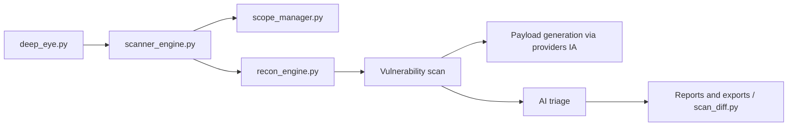

# zakirkun/deep-eye

> AI-driven web vulnerability scanner, for authorized penetration-testing teams.

## The problem
A web audit chains reconnaissance, dozens of checks, false-positive triage and report writing: long and repetitive by hand.

## What it actually does
- Takes a target URL, performs reconnaissance and a scope-bounded sweep (`scope_manager.py`, `--scope-nl` option in natural language).
- Runs more than 50 vulnerability checks, with payloads generated by an AI model from about ten providers (or local Ollama).
- Triages results with AI, deduplicates, and produces reports (HTML, PDF, JSON, SARIF, JUnit, CSV, XLSX) with PCI-DSS, SOC2, ISO 27001 mapping.
- Compares two scans (`scan_diff.py`) and keeps only new findings on retest.

## How it is wired


## Trying it
```bash
pip install -r requirements.txt
cp config/config.example.yaml config/config.yaml   # renseigner les clés d'API
python deep_eye.py -u https://target.com
python deep_eye.py --diff baseline.json current.json --diff-format html --diff-output diff_report.html
```

## Cost and gotchas
At least one API key from an AI provider (billed per use) or a local Ollama. A license is present but not identified by GitHub: check before any enterprise use.

## What it is not
Not a tool to point at a third-party system: the README states use is reserved for authorized testing, on systems you own or with written permission; any unauthorized access is illegal. An AI-assisted scanner does not replace human validation of findings.

## Alternatives
Nuclei-style templates (cited for the YAML template format): a more established ecosystem for declarative checks.

## For you
Watch: relevant if you run authorized audits and want to see multi-LLM orchestration, but the project is young, has a single maintainer and an unclear license.
