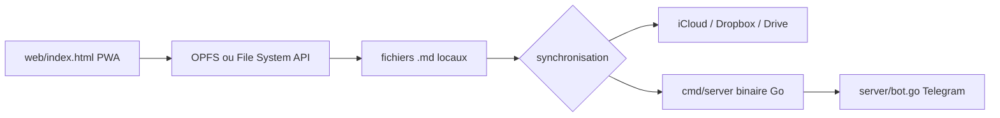

# zakirullin/files.md

> Local web app that manages notes, journal, tasks and lists as `.md` files.

## The problem
Note-taking tools lock content into their format and plugins.
The system grows, and the work of thinking is pushed to a future self that never arrives.

## What it actually does
Everything is stored as local `.md` files, in the browser; files do not leave the device by default.
A chat flow (`Cmd+Enter`) to drop a thought, then file it into a note, the journal or a list.
A predefined folder structure: `brain/`, `journal/YYYY.MM Month.md`, `Later.md`, `habits/`.
No build, no Electron: `web/index.html` opens directly; synchronization is optional.

## How it is wired


## Trying it
```
go run /abs/path/to/files.md/cmd/backlink/backlink.go
```
The main usage requires no installation: open app.files.md, then "Install files.md" in the address bar.

## Cost and gotchas
Free. Chromium browsers are the only ones that handle the File System API well, according to the author.
Hosted synchronization goes through `api.files.md`, a service run by the maintainer: it is an external dependency.

## What it is not
Not an Obsidian: the project argues against plugins, templates and the "second brain".
Not a team tool — everything is designed for personal local use.
A good half of the README is an essay on note-taking, not documentation.

## Alternatives
Obsidian, cited in the README as the reference the project distances itself from.

## For you
Interesting for the "one idea per note" discipline; the minimal code is readable if you want to tinker with it.
