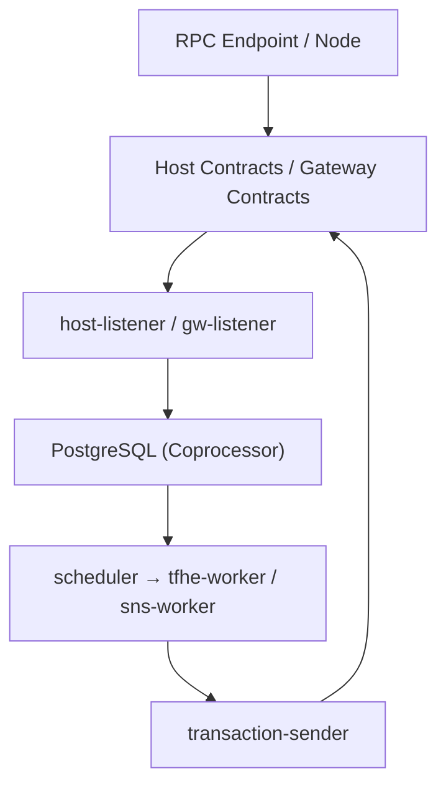

# zama-ai/fhevm

> Framework for confidential smart contracts on EVM blockchains, based on homomorphic encryption.

## The problem
Smart contract data is readable by everyone on the chain, which rules out private amounts or votes.

## What it actually does
Solidity contracts manipulate encrypted integers (up to 256 bits). Operations are executed symbolically on the host chain, then computed asynchronously by a Rust coprocessor. Keys are managed by a KMS with multi-party computation. The repository contains contracts, coprocessor, KMS connector, Helm charts and a test suite.

## How it is wired

## Trying it
No command in the README: it points to the documentation, examples and test suite (test-suite/, docker-compose).

## Cost and gotchas
BSD 3-Clause Clear license: free for research and prototyping only; any commercial use requires a paid patent license from Zama. The stack requires Docker, PostgreSQL, object storage and Kubernetes (Helm).

## What it is not
Not free for commercial use despite the open code. Not a simple package to install: it is a stack of services. Foundry support is announced as "coming soon".

## Alternatives
No alternative named in the README.

## For you
Watch: interesting for computation confidentiality, but the commercial license and deployment complexity hold back any production use.
