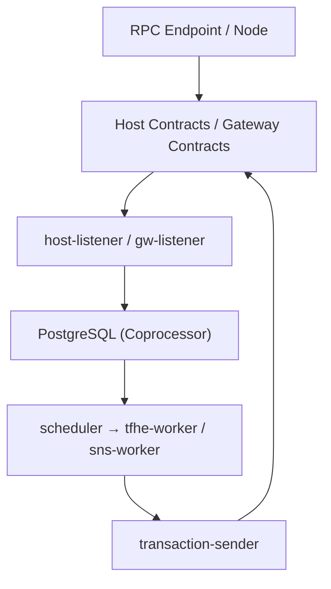

# zama-ai/fhevm

> Framework de contrats intelligents confidentiels sur blockchains EVM, fondé sur le chiffrement homomorphe.

## Le problème
Les données d'un contrat intelligent sont lisibles par tous sur la chaîne, ce qui exclut les montants ou votes privés.

## Ce que ça fait vraiment
Les contrats Solidity manipulent des entiers chiffrés (jusqu'à 256 bits). Les opérations sont exécutées symboliquement sur la chaîne hôte, puis calculées de façon asynchrone par un coprocesseur Rust. Les clés sont gérées par un KMS avec calcul multipartite. Le dépôt contient contrats, coprocesseur, connecteur KMS, charts Helm et suite de tests.

## Comment c'est branché

## Essayer
Aucune commande dans le README : il renvoie à la documentation, aux exemples et à la suite de tests (test-suite/, docker-compose).

## Coût et pièges
Licence BSD 3-Clause Clear : gratuite pour la recherche et le prototypage seulement ; tout usage commercial exige une licence de brevet payante de Zama. La pile demande Docker, PostgreSQL, un stockage objet et Kubernetes (Helm).

## Ce que ce n'est pas
Pas libre pour un usage commercial malgré le code ouvert. Pas un simple paquet à installer : c'est une pile de services. Le support Foundry est annoncé « bientôt ».

## Alternatives
Aucune alternative nommée dans le README.

## Pour toi
À surveiller : intéressant pour la confidentialité des calculs, mais la licence commerciale et la complexité de déploiement freinent tout usage en production.

