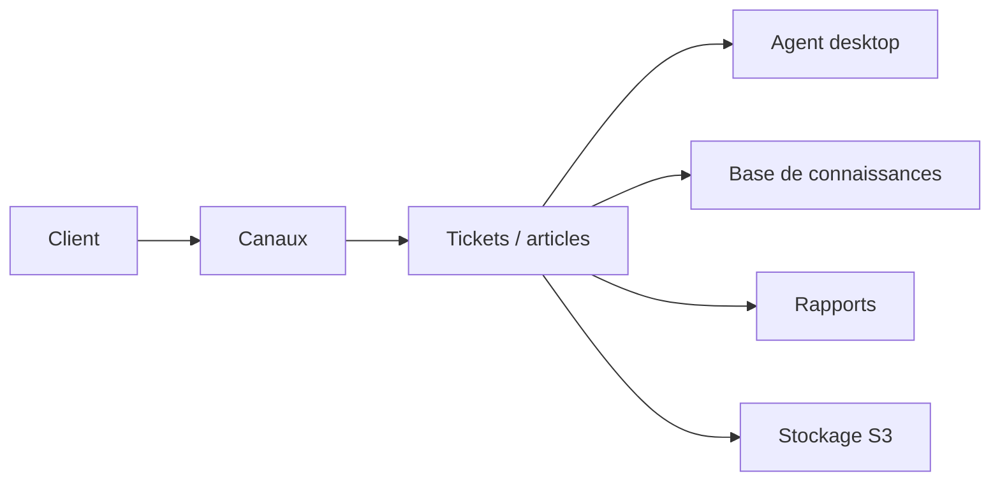

# zammad/zammad

> Open source multichannel customer support web platform, for support teams.

## The problem
Customer requests arrive by email, chat, phone and social networks, and the team loses the overall view.

## What it actually does
It centralizes exchanges as tickets with articles, groups and roles, a knowledge base, reports, integrations and AI assistance. Judging from the code: a Vue agent desktop, a GraphQL API, configurable objects, S3 storage. The code belongs to the Zammad Foundation; Zammad GmbH offers a paid cloud service with a trial.

## How it is wired

## Trying it
No command in the README: Docker images, a Helm chart and DEB/RPM packages are mentioned.

## Cost and gotchas
Self-hosting is free, with operations (backup, updates) on you; the cloud offering is paid.

## What it is not
Not a data/AI tool: a helpdesk. AGPLv3 license to examine if you integrate it.

## Alternatives
No alternative named in the README.

## For you
Ignore: customer support domain, unrelated to your data/AI/MLOps profile.
