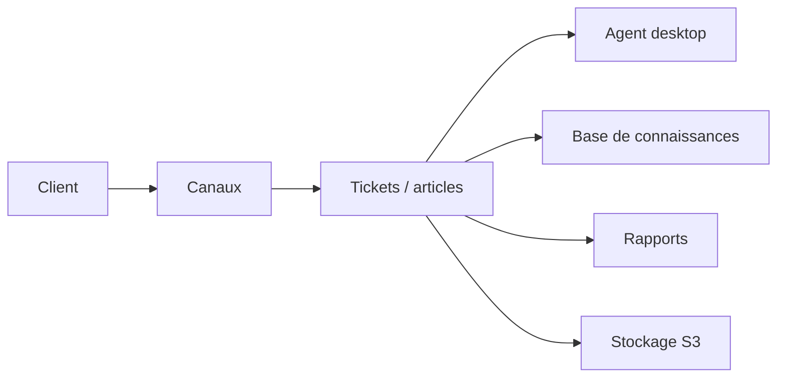

# zammad/zammad

> Plateforme web open source de support client multicanal, pour équipes d'assistance.

## Le problème
Les demandes clients arrivent par e-mail, chat, téléphone et réseaux sociaux, et l'équipe perd la vue d'ensemble.

## Ce que ça fait vraiment
Elle centralise les échanges en tickets avec articles, groupes et rôles, base de connaissances, rapports, intégrations et assistance IA. D'après le code : bureau agent en Vue, API GraphQL, objets configurables, stockage S3. Le code appartient à la Zammad Foundation ; Zammad GmbH propose un service cloud payant avec essai.

## Comment c'est branché

## Essayer
Aucune commande dans le README : images Docker, chart Helm et paquets DEB/RPM sont cités.

## Coût et pièges
Auto-hébergement gratuit, avec opérations (sauvegarde, mises à jour) à ta charge ; l'offre cloud est payante.

## Ce que ce n'est pas
Pas un outil data/IA : un helpdesk. Licence AGPLv3 à examiner si tu l'intègres.

## Alternatives
Aucune alternative nommée dans le README.

## Pour toi
À ignorer : domaine support client, sans rapport avec ton profil data/IA/MLOps.

