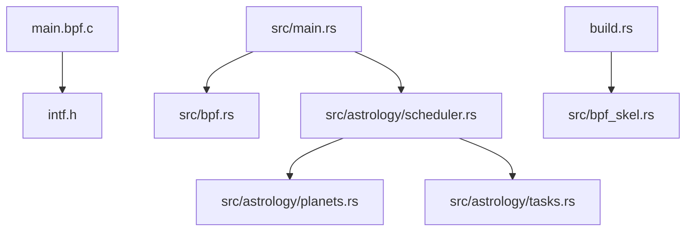

# zampierilucas/scx_horoscope

> Linux sched_ext CPU scheduler based on planetary positions, built for humor and teaching.

## The problem
None, strictly speaking: it is a humorous demonstration of what sched_ext allows, for talks and hackathons.

## What it actually does
Loads an eBPF scheduler into the kernel that ranks tasks by planetary domain, applies bonuses or penalties according to the zodiac elements, and halves the quantum during retrograde. Positions come from the `astro` crate. Durations are recomputed every 60 s by default. The README states it runs stably but advises against production use.

## How it is wired


## Trying it
```bash
cargo build --release
sudo target/release/scx_horoscope --cosmic-weather -v
sudo target/release/scx_horoscope --debug-decisions
```

## Cost and gotchas
Free. Linux kernel 6.12 or newer and root rights required; Rust toolchain needed (not listed in the prerequisites). No license declared.

## What it is not
Not a serious scheduler: "scientifically dubious" according to the author, and with no clear license.

## Alternatives
No alternative named in the README (it builds on scx_rustland_core).

## For you
Ignore: fun for understanding sched_ext, but of no value to a data, AI or MLOps profile and without a license.
