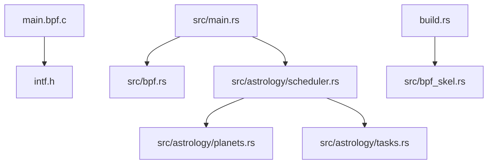

# zampierilucas/scx_horoscope

> Planificateur CPU Linux sched_ext fondé sur les positions planétaires, pensé pour l'humour et la pédagogie.

## Le problème
Aucun, au sens strict : c'est une démonstration humoristique de ce que permet sched_ext, pour conférences et hackathons.

## Ce que ça fait vraiment
Charge dans le noyau un ordonnanceur eBPF qui classe les tâches par domaine planétaire, applique des bonus ou malus selon les éléments du zodiaque, et divise par deux le quantum en cas de rétrograde. Les positions viennent de la crate `astro`. Les durées sont recalculées toutes les 60 s par défaut. Le README précise qu'il tourne de façon stable mais le déconseille en production.

## Comment c'est branché


## Essayer
```bash
cargo build --release
sudo target/release/scx_horoscope --cosmic-weather -v
sudo target/release/scx_horoscope --debug-decisions
```

## Coût et pièges
Gratuit. Noyau Linux 6.12 ou plus récent et droits root requis ; toolchain Rust nécessaire (non listée dans les prérequis). Aucune licence déclarée.

## Ce que ce n'est pas
Pas un ordonnanceur sérieux : « scientifiquement douteux » selon l'auteur, et sans licence claire.

## Alternatives
Aucune alternative nommée dans le README (il s'appuie sur scx_rustland_core).

## Pour toi
Ignorer : amusant pour comprendre sched_ext, mais sans valeur pour un profil data, IA ou MLOps et sans licence.

