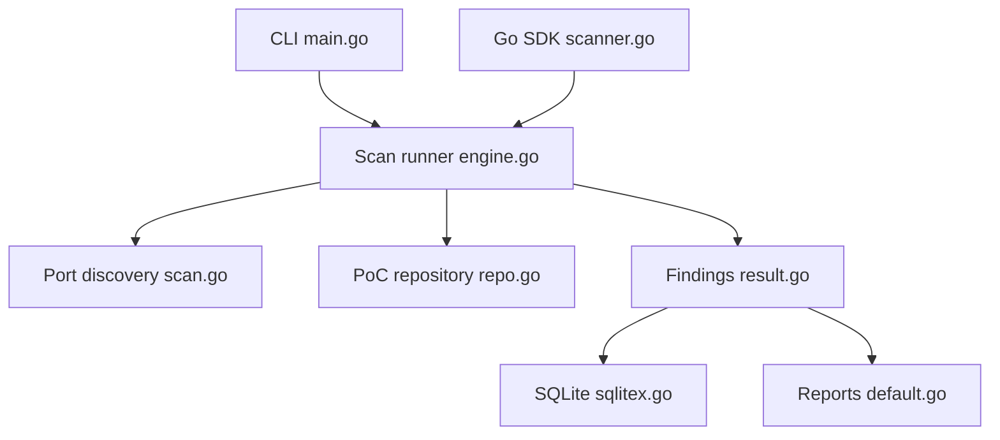

# zan8in/afrog

> Go vulnerability scanner with built-in or custom PoCs, for authorized security audits.

## The problem
Checking that a known flaw really affects a target requires repetitive checks, with a risk of false positives.

## What it actually does
The CLI receives targets and options, does port discovery and fingerprinting, runs PoCs (built-in or written by the user, validated), then produces results and reports. It is also exposed through a Go SDK, a gRPC API and a web console; results can be stored in SQLite and notified. An optional licensed "curated" PoC service exists.

## How it is wired


## Trying it
```bash
go install -v github.com/zan8in/afrog/v3/cmd/afrog@latest
afrog -t https://example.com
afrog -T targets.txt -S high,critical
```

## Cost and gotchas
Free (MIT); Go 1.27+ to build. English documentation still incomplete (Chinese is more complete). 111 open issues.

## What it is not
Not a tool to run on targets without authorization: the README specifies legally authorized use only. The curated PoCs belong to a licensed service, not detailed.

## Alternatives
- No alternative named in the README.

## For you
Worth watching: useful only if you audit your own exposed services; outside the security scope, it brings nothing to a data / AI / MLOps profile.
