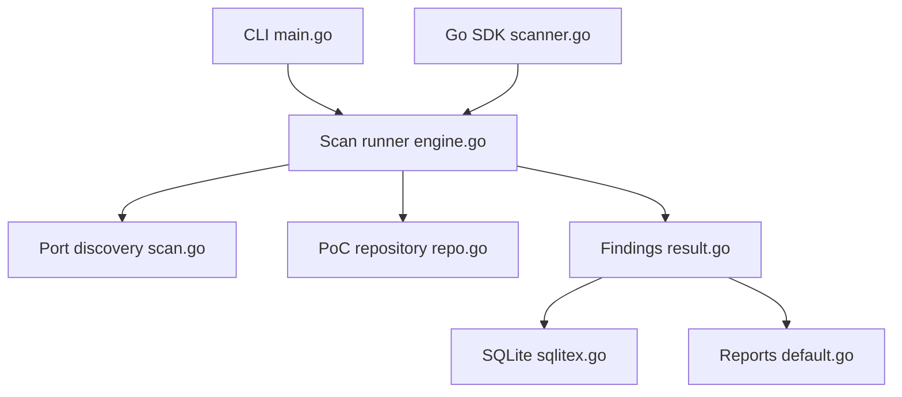

# zan8in/afrog

> Scanner de vulnérabilités en Go avec PoC intégrés ou personnalisés, pour audits de sécurité autorisés.

## Le problème
Vérifier qu'une faille connue touche bien une cible demande des contrôles répétitifs, avec risque de faux positifs.

## Ce que ça fait vraiment
Le CLI reçoit des cibles et des options, fait de la découverte de ports et du fingerprinting, exécute des PoC (intégrés ou écrits par l'utilisateur, validés), puis produit des résultats et des rapports. Il est aussi exposé par un SDK Go, une API gRPC et une console web ; les résultats peuvent être stockés dans SQLite et notifiés. Un service de PoC « curated » sous licence existe en option.

## Comment c'est branché


## Essayer
```bash
go install -v github.com/zan8in/afrog/v3/cmd/afrog@latest
afrog -t https://example.com
afrog -T targets.txt -S high,critical
```

## Coût et pièges
Gratuit (MIT) ; Go 1.27+ pour compiler. Documentation anglaise encore incomplète (chinois plus complet). 111 issues ouvertes.

## Ce que ce n'est pas
Pas un outil à lancer sur des cibles sans autorisation : le README précise un usage légalement autorisé uniquement. Les PoC curated relèvent d'un service sous licence, non détaillé.

## Alternatives
- Aucune alternative nommée dans le README.

## Pour toi
À surveiller : utile seulement si tu audites tes propres services exposés ; hors périmètre sécurité, il n'apporte rien à un profil data / IA / MLOps.

