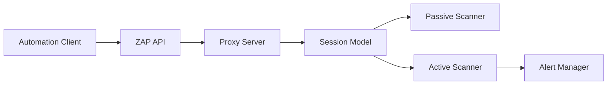

# zaproxy/zaproxy

> Free web application security scanner and intercepting proxy, for developers and pentesters.

## The problem
Finding vulnerabilities in a web application during its development and testing.

## What it actually does
Minimal README. From the code: a proxy that intercepts traffic, stores messages in a session, passes them to the passive and active scanners, and produces alerts and reports. Desktop interface, headless mode and API, authentication, add-ons, TLS interception, manual request editing.

## How it is wired

## Trying it
No command documented in the README; see zaproxy.org.

## Cost and gotchas
Free. An active scan attacks the target: run it only on what you are authorized to test. Very short README: minimal fiche.

## What it is not
Not an LLM API testing tool nor a model security tool. Implementation details were not read.

## Alternatives
No alternative named in the README.

## For you
Worth watching: useful for auditing the web API that serves your models before going to production.
