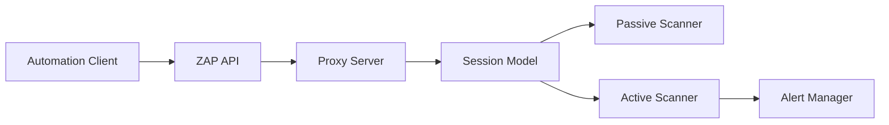

# zaproxy/zaproxy

> Scanner de sécurité d'applications web et proxy d'interception, libre, pour développeurs et pentesters.

## Le problème
Trouver des vulnérabilités dans une application web pendant son développement et ses tests.

## Ce que ça fait vraiment
README minimal. D'après le code : proxy qui intercepte le trafic, stocke les messages dans une session, les passe aux scanners passif et actif, produit des alertes et rapports. Interface de bureau, mode sans interface et API, authentification, add-ons, interception TLS, édition manuelle de requêtes.

## Comment c'est branché

## Essayer
Aucune commande documentée dans le README ; voir zaproxy.org.

## Coût et pièges
Gratuit. Un scan actif attaque la cible : à lancer seulement sur ce qu'on est autorisé à tester. README très court : fiche minimale.

## Ce que ce n'est pas
Pas un outil de test d'API LLM ni de sécurité de modèles. Les détails d'implémentation n'ont pas été lus.

## Alternatives
Aucune alternative nommée dans le README.

## Pour toi
À surveiller : utile pour auditer l'API web qui sert tes modèles avant mise en production.

