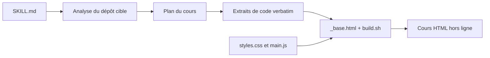

# zarazhangrui/codebase-to-course

> Claude Code skill that turns a repository into an interactive HTML course for non-traditional developers.

## The problem
You have a working project, often written with an agent, but you don't understand how it works. It is hard to steer the AI, spot its mistakes or talk to engineers.

## What it actually does
A `SKILL.md` folder plus references that Claude Code reads: it analyzes the target repository, plans a curriculum around the application's real flows, extracts unmodified code excerpts, then assembles a single offline HTML page with scroll navigation, quizzes, animations and code ↔ plain-language translations.

## How it is wired


## Trying it
```bash
# copier le dossier codebase-to-course dans ~/.claude/skills/
# puis, dans Claude Code, sur n'importe quel projet :
# "Turn this codebase into an interactive course"
```

## Cost and gotchas
No installation, but generation consumes the tokens of your Claude Code session. No license declared: use and redistribution not guaranteed.

## What it is not
Neither an application nor a service: only instructions for an agent. Course quality depends on the model and the size of the repository; no tests or sample output are described.

## Alternatives
- No alternative named in the README.

## For you
Worth watching: the idea of a course generated from code is useful for onboarding onto a data/AI repository, but the missing license and a last push in March 2026 suggest waiting before depending on the skill.
