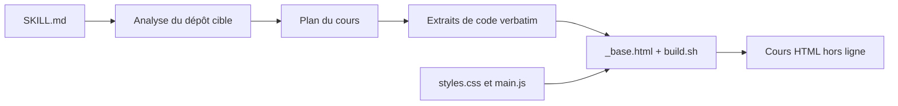

# zarazhangrui/codebase-to-course

> Skill Claude Code qui transforme un dépôt en cours HTML interactif pour des développeurs non traditionnels.

## Le problème
On a un projet qui marche, souvent écrit avec un agent, mais on ne comprend pas comment il fonctionne. Difficile de piloter l'IA, de repérer ses erreurs ou de parler aux ingénieurs.

## Ce que ça fait vraiment
Un dossier `SKILL.md` + références que Claude Code lit : il analyse le dépôt cible, planifie un cursus autour des flux réels de l'application, extrait des extraits de code non modifiés, puis assemble une seule page HTML hors ligne avec navigation par scroll, quiz, animations et traductions code ↔ langage courant.

## Comment c'est branché


## Essayer
```bash
# copier le dossier codebase-to-course dans ~/.claude/skills/
# puis, dans Claude Code, sur n'importe quel projet :
# "Turn this codebase into an interactive course"
```

## Coût et pièges
Pas d'installation, mais la génération consomme les tokens de ta session Claude Code. Aucune licence déclarée : usage et redistribution non garantis.

## Ce que ce n'est pas
Ni application ni service : seulement des instructions pour un agent. La qualité du cours dépend du modèle et de la taille du dépôt ; aucun test ni exemple de sortie n'est décrit.

## Alternatives
- Aucune alternative nommée dans le README.

## Pour toi
À surveiller : l'idée de cours généré depuis le code est utile pour onboarder sur un dépôt data/IA, mais l'absence de licence et un dernier push de mars 2026 invitent à attendre avant de dépendre du skill.

