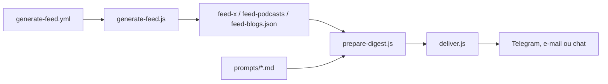

# zarazhangrui/follow-builders

> Agent skill (Claude Code or OpenClaw) that sends a digest of AI podcasts, X posts and blogs.

## The problem
Following what the people who actually build in AI are saying, without going through influencer relays.

## What it actually does
A central daily feed (GitHub Actions) aggregates blogs by scraping, YouTube transcripts via Supadata and X posts through the official API; the local agent fetches it, summarizes it with prompt files in plain English, translates if needed and delivers via Telegram, e-mail or in the chat. Default sources: 6 podcasts, 26 X accounts, 2 blogs.

## How it is wired


## Trying it
```bash
git clone https://github.com/zarazhangrui/follow-builders.git ~/.claude/skills/follow-builders
cd ~/.claude/skills/follow-builders/scripts && npm install
```
Then tell the agent "set up follow builders" or invoke `/follow-builders`.

## Cost and gotchas
No API key to provide, but everything depends on the author's central feed: if it stops, the digest stops. No license declared. Telegram or e-mail keys stay local in `~/.follow-builders/.env`.

## What it is not
Not a source-customizable watch: the list is managed centrally and updates itself.

## Alternatives
No alternative is named in the README.

## For you
Worth watching: handy for a ready-made AI watch inside Claude Code, but without a license and dependent on a central feed run by a single person.
