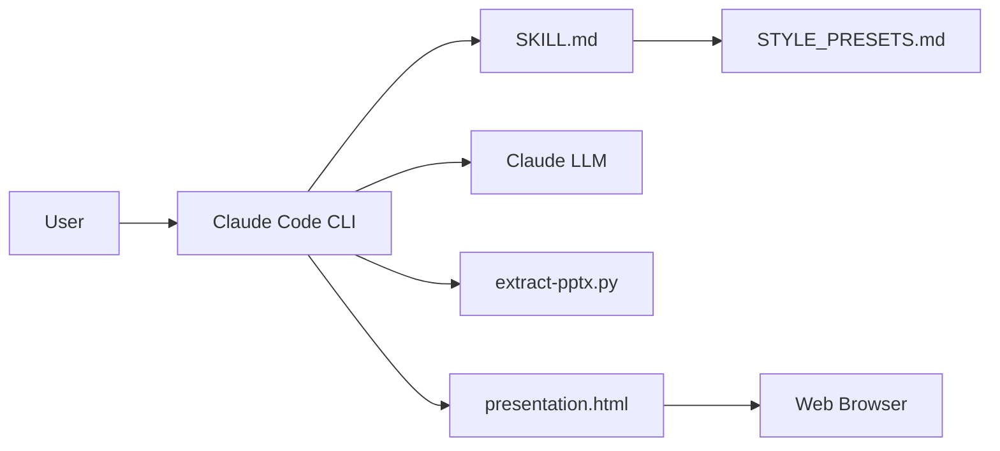

# zarazhangrui/frontend-slides

> Skill for coding agents that generates standalone HTML presentations or converts PPTX files.

## The problem
Producing a polished deck without knowing CSS/JS or how to put your visual tastes into words takes time and often yields a generic result.

## What it actually does
A `SKILL.md` guides the agent: content gathering, three style previews, a choice, then generation of a single HTML file (inline CSS/JS, 16:9).
Styles come from `STYLE_PRESETS.md` (12 presets) and a pack of 34 progressively loaded templates.
PPTX conversion via `scripts/extract-pptx.py` (python-pptx).
Sharing scripts: Vercel deployment and PDF export via Playwright.

## How it is wired


## Trying it
```bash
git clone https://github.com/zarazhangrui/frontend-slides.git ~/.claude/skills/frontend-slides
bash scripts/deploy.sh ./presentation.html
bash scripts/export-pdf.sh ./presentation.html ./output.pdf
```

## Cost and gotchas
Free, but it consumes your agent's tokens. PPTX: python-pptx; deployment: Node.js + Vercel account; PDF: Node.js.

## What it is not
Not a slide editor: everything goes through the agent. PDF export loses the animations. Quality depends on the LLM used.

## Alternatives
No alternative named in the README (only `beautiful-html-templates` is cited as a template source).

## For you
Worth watching: useful for quick decks outside a brand template; for a presentation that must follow a brand guide, a dedicated generator remains preferable.
